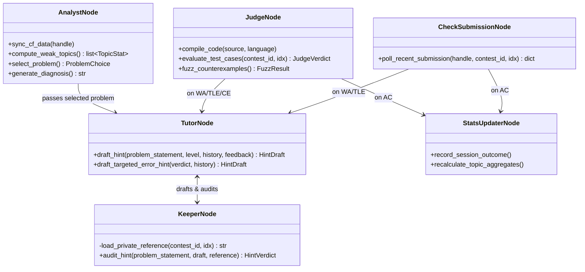
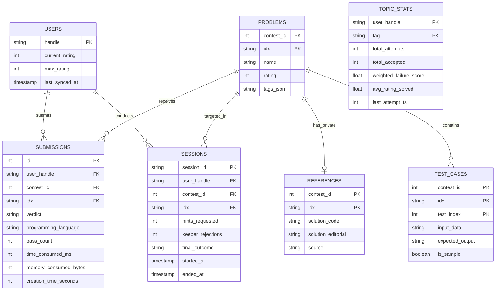

# System Architecture: CP Coach

## 1. Overview
CP Coach is designed as an agentic state machine orchestrated by **LangGraph**. The primary design driver is **pedagogical integrity through information asymmetry**.

---

## 2. LangGraph State Machine Architecture

```mermaid
flowchart TD
    subgraph Initialization
        START([START]) --> analyst_node[Analyst Node]
    end

    subgraph UserInteraction ["User Checkpoint (wait_for_user)"]
        analyst_node --> wait_user[wait_for_user Interrupt / Checkpoint]
        wait_user --> route_action{Route User Action}
    end

    subgraph TutoringLoop ["Tutor ⇄ Keeper Verification Loop"]
        route_action -- action == 'request_hint' --> tutor_node[Tutor Node\n(Solution-Blind Draft)]
        tutor_node --> keeper_node[Keeper Node\n(Private Solution Audit)]
        keeper_node --> keeper_verdict{Approved or Revisions >= 3?}
        keeper_verdict -- "No (Reject & Revisions < 3)" --> tutor_node
        keeper_verdict -- "Yes (Approve OR Fallback)" --> wait_user
    end

    subgraph SubmissionHandling ["Submission & Sandbox Judge Execution"]
        route_action -- action == 'submit_code' --> judge_node[Sandbox Judge Node\n(Compile & Run Tests)]
        judge_node --> judge_verdict{Judge Verdict == AC?}
        judge_verdict -- "Yes (AC)" --> update_stats_node
        judge_verdict -- "No (WA / TLE / MLE / CE / RE)" --> tutor_targeted_node

        route_action -- action == 'submitted' --> check_submission_node[Check Submission Node\n(Poll Remote CF)]
        check_submission_node --> sub_verdict{Verdict == AC?}
        sub_verdict -- "Yes (AC)" --> update_stats_node[Update DB Stats]
        update_stats_node --> analyst_node
        sub_verdict -- "No (WA / TLE)" --> tutor_targeted_node[Tutor Targeted Hint]
        tutor_targeted_node --> keeper_node
    end

    subgraph GraphExit
        route_action -- action == 'skip' --> analyst_node
        route_action -- action == 'done' --> END([END])
    end
```

---

## 3. Node Responsibilities & Boundaries



---

## 4. Database Schema (`app/data/db.py`)

SQLite is used as the single embedded persistence layer. All tables are defined with strict types and primary/foreign keys.



---

## 5. Information Asymmetry Deep Dive

```
+-----------------------------------------------------------------------------+
|                                SHARED STATE                                 |
| (CoachState: problem metadata, statement, hint level, compact chat history) |
+-----------------------------------------------------------------------------+
               |                                              |
               v                                              v
+-----------------------------+                +------------------------------+
|         TUTOR NODE          |                |         KEEPER NODE          |
|                             |                |                              |
| Inputs:                     |                | Inputs:                      |
|  - problem_statement        |                |  - problem_statement         |
|  - hint_level (1, 2, or 3)  |                |  - Tutor's draft             |
|  - compact chat history     |                |  - Private Reference Sol.   |
|                             |                |    (Loaded directly from DB) |
| Output:                     |                | Output:                      |
|  - HintDraft(text, level)   |                |  - HintVerdict(approved,...) |
+-----------------------------+                +------------------------------+
               |                                              ^
               |               Draft for verification         |
               +----------------------------------------------+
```

### Why this structure prevents hallucination & leakage:
1. **Zero Exposure for Tutor**: The prompt to the Tutor never contains the solution. Even if the Tutor model hallucinates or over-explains, it can only speculate based on the problem statement.
2. **Dual-Mode Keeper Verification**:
   - **Mode A (Solution-Aware)**: When a reference solution is available in SQLite `references`, Keeper performs a strict comparative diff to ensure no implementation code or variables are leaked.
   - **Mode B (Heuristic Rubric Mode)**: When practicing unseen or ad-hoc problems without database editorials, Keeper automatically engages zero-shot rubric verification to audit structural constraints (blocking code blocks, variable declarations, and premature algorithmic disclosures).
3. **Graceful Degeneracy Handling**: If the Tutor drafts 3 consecutive invalid hints, the system replaces the output with a pre-vetted generic heuristic (e.g., "Review problem constraints and try writing out small examples by hand").

---

## 6. Algorithmic Tag Filtering & Noise Suppression Policy

To preserve high pedagogical value, the deterministic stats engine and recommendation router explicitly filter out non-algorithmic and administrative Codeforces tags:
- **Filtered Meta-Tags**: `*special`, `special problem`, `special problems`, `interactive`, `combine tags by or`, `submit fail`.
- **Core Algorithmic Focus**: Only genuine algorithmic topics (`dp`, `graphs`, `trees`, `math`, `greedy`, `data structures`, `binary search`, `strings`, `geometry`, `number theory`, `bitmasks`, etc.) are scored in topic aggregates and recommended to users.
