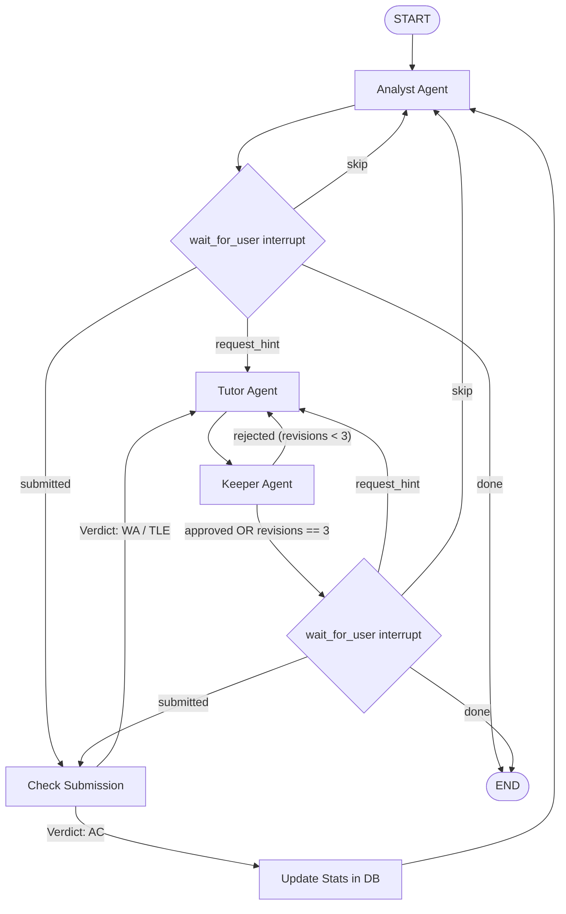

# Project Context: CP Coach (Multi-Agent Competitive Programming Coach)

## 1. Project Overview & Vision

**CP Coach** is an intelligent, multi-agent coaching system built with **Python 3.11+**, **LangGraph**, **Pydantic**, **SQLite**, and **Streamlit**. It connects to a user's Codeforces profile, analyzes their past contest and submission history to identify weak algorithm topics, recommends suitably challenging practice problems (rating target: solved level +100 to +200), and guides them through solving the problem using **progressive, graded hints that strictly avoid leaking the solution**.

### The Core Problem Solved
Traditional AI tutors and editorial solutions spoil competitive programming problems by immediately revealing the key observation or full algorithm. Once spoiled, the pedagogical value of solving the problem is lost. 

CP Coach uses **multi-agent information asymmetry** to guarantee pedagogical integrity:
- The **Tutor Agent** communicates with the user and drafts hints *without ever seeing the reference solution*.
- The **Keeper Agent** inspects the reference solution privately and *audits the Tutor's hint drafts*, rejecting any hint that leaks algorithms, code, or key insights ahead of the requested hint tier.

---

## 2. Multi-Agent Topology & Information Asymmetry

| Agent | What it Sees | What it Does | Why Separate (Boundary) |
| :--- | :--- | :--- | :--- |
| **Analyst** | Submissions, problem tags, ratings | Computes weak topics deterministically, selects next problem, drafts short diagnosis | Owns data parsing, scoring formulas, and DB sync. Heavy logic is pure deterministic code. |
| **Tutor** | Problem statement, user chat messages, previous accepted hints | Talks to user, drafts hints at levels 1, 2, or 3 | **Cannot leak what it does not know.** Structurally blind to reference solution. |
| **Keeper** | Problem statement + Reference solution (read privately from DB) | Evaluates and approves/rejects Tutor hint drafts with constructive feedback | **Core multi-agent justification.** Enforces hint safety and rubric compliance. |
| **Judge** *(Phase 8)* | User code submission, test suite | Runs code in sandbox, reports execution verdicts (AC, WA, TLE, MLE) | Isolated execution environment with time/memory resource limits. |

---

## 3. High-Level Graph Flow

---

## 4. Key Architectural Invariants

1. **State Isolation**: The shared graph state (`CoachState`) **MUST NEVER** contain the reference solution or full editorial code. The reference solution is loaded on-demand exclusively inside the `keeper_node` from private storage (`references` SQLite table).
2. **Deterministic Computation First**: Problem stats, failure rates, Bayesian shrinkage, exponential decay, and problem filtering are executed in pure Python code (`data/stats.py`). LLMs are only invoked when natural language generation/evaluation is needed.
3. **Loop Termination Guarantee**: The `Tutor ⇄ Keeper` revision loop is strictly capped at **3 revisions**. If the 3rd draft is still rejected, the system yields a safe, generic fallback hint to prevent infinite loops and runaway token costs.
4. **State Size Minimization**: Shared state stores IDs, metadata summaries, and compact conversation turns—never massive raw JSON blobs or entire API payloads.
5. **Human-in-the-Loop Interrupts**: The system pauses at `wait_for_user` using LangGraph interrupts/checkpointers, waiting for explicit user inputs (`request_hint`, `submit`, `skip`, `chat`).

---

## 5. Mathematical Scoring Specification (`data/stats.py`)

For each tag $T$, we compute a **Weighted Failure Rate** $WFR(T)$:

$$WFR(T) = \frac{\sum_{i \in \text{attempts}(T)} w_i \cdot \mathbb{I}(\text{verdict}_i \neq \text{AC})}{\sum_{i \in \text{attempts}(T)} w_i}$$

Where weight $w_i$ combines **Difficulty Weight** and **Recency Decay**:
- **Difficulty Weight ($d_i$)**: $d_i = \max\left(0.5, \frac{\text{Rating}_i}{\text{UserCurrentRating}}\right)$. Failing a 1600 problem when rated 1400 carries more weight than failing an 800 problem.
- **Recency Decay ($r_i$)**: Exponential decay with a 30-day half-life:
  $$r_i = \exp\left(-\frac{\Delta t_i \cdot \ln 2}{30 \text{ days}}\right)$$
- **Sample Size Shrinkage (Empirical Bayes)**: For tags with very few attempts ($n < 10$), shrink toward global failure rate $\mu$:
  $$\text{AdjustedScore}(T) = \frac{n \cdot WFR(T) + m \cdot \mu}{n + m} \quad (\text{with default prior weight } m = 5)$$

### Problem Selection Rule:
- Top 3 weak tags by adjusted failure score.
