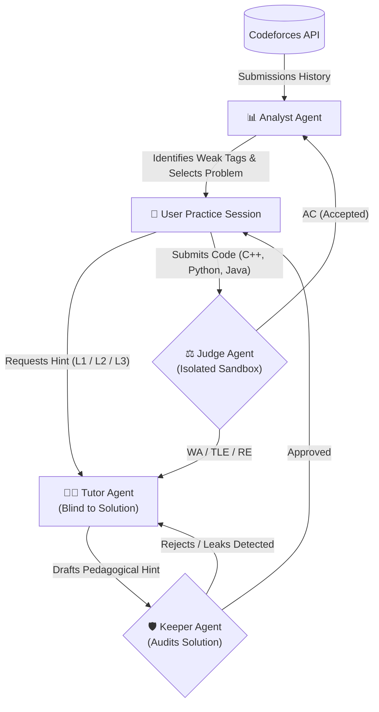

# Son of Aviral: Multi-Agent Competitive Programming Coach

[](https://www.python.org/downloads/)
[](https://github.com/langchain-ai/langgraph)
[](https://docs.pydantic.dev/)
[](https://streamlit.io/)
[](https://www.docker.com/)

A multi-agent coaching system that connects to your **Codeforces** history, calculates your weak algorithmic topics using exponential decay and empirical Bayes shrinkage, picks a tailored practice problem, and coaches you with **graded, 3-tier hints that strictly never leak the solution**.

Named in homage to Gilfoyle’s sentient creation **Son of Anton** from *Silicon Valley*, **Son of Aviral** was built out of deep contempt for inefficiency and manual editorial lookups. It exists to automate your algorithmic progression and ensure you stop submitting O(N^3) brute-force solutions on Test 2.

---

## 1. Core Architecture & Multi-Agent Justification

Standard LLMs and editorial walkthroughs spoil competitive programming problems by immediately revealing the key observation or full algorithm. Once spoiled, active recall and problem-solving growth is lost.

CP Coach solves this through **Multi-Agent Information Asymmetry**:
- **Tutor Agent**: Sees *only* the problem statement and user chat history. It drafts hints at the requested tier (Level 1: Nudge, Level 2: Approach, Level 3: Pseudocode) without ever seeing the reference solution.
- **Keeper Agent**: An independent auditor that loads the reference solution privately from database storage and verifies that the Tutor's draft does not leak algorithms, variable names, or solutions.
- **Judge Agent**: Executes code submissions locally in an isolated sandbox (C++17, Python 3, Java) or via remote Judge0 CE with CPU timeout/memory limits and differential stress fuzzing against ground-truth reference code.
- **Analyst Agent**: Evaluates submission history, computes weak topics using deterministic math, and selects an optimal problem.



---

## 2. Production Hardening

- **Sandbox Security**: Stripped subprocess environment blocking Python introspection (`__subclasses__`, `__builtins__`) and C++ filesystem access.
- **Container Hardening**: Unprivileged non-root user (`appuser` UID 1001) with dropped Linux capabilities (`cap_drop: [ALL]`) and `no-new-privileges`.
- **Nginx Reverse Proxy**: Built-in rate limiting, security headers, and WebSocket upgrade support for Streamlit.
- **SQLite WAL Mode & State Persistence**: High-concurrency `PRAGMA journal_mode = WAL` and persistent LangGraph checkpoints via `SqliteSaver`.
- **Rate Limiting & Observability**: Token-bucket DoS protection, automated health checks (`healthcheck.py`), and LangSmith distributed tracing.

---

## 3. Configuration

```bash
cp .env.example .env
```

| Key | Default | Description |
| :--- | :--- | :--- |
| `GOOGLE_API_KEY` | — | Google Gemini API key (recommended free) |
| `OPENROUTER_API_KEY` | — | Optional OpenRouter API key |
| `TUTOR_MODEL_NAME` | `gemini-3.5-flash` | Hint generator model |
| `KEEPER_MODEL_NAME` | `gemini-3.5-flash` | Safety auditor model |
| `ANALYST_MODEL_NAME` | `gemini-3.5-flash` | Diagnostics model |
| `JUDGE_BACKEND` | `isolated_subprocess` | Code execution engine |
| `DATABASE_PATH` | `cp_coach.db` | SQLite storage path |

---

## 4. Running & Deployment

### Local Setup
```bash
pip install -r requirements.txt
streamlit run app/ui/streamlit_app.py
```

### Docker (Production + Nginx)
```bash
docker compose up --build -d
# Accessible at http://localhost
```

### Streamlit Community Cloud (Free)
1. Deploy from [share.streamlit.io](https://share.streamlit.io/) with file path `app/ui/streamlit_app.py`.
2. In **Advanced settings → Secrets**, paste:
   ```toml
   GOOGLE_API_KEY = "AIzaSy..."
   TUTOR_MODEL_NAME = "gemini-3.5-flash"
   KEEPER_MODEL_NAME = "gemini-3.5-flash"
   ANALYST_MODEL_NAME = "gemini-3.5-flash"
   ```

---

## 5. Automated Tests

```bash
pytest tests/ -v
```
Runs 107 deterministic offline tests covering multi-agent loops, sandbox security, and rating statistics with zero API quota usage.
