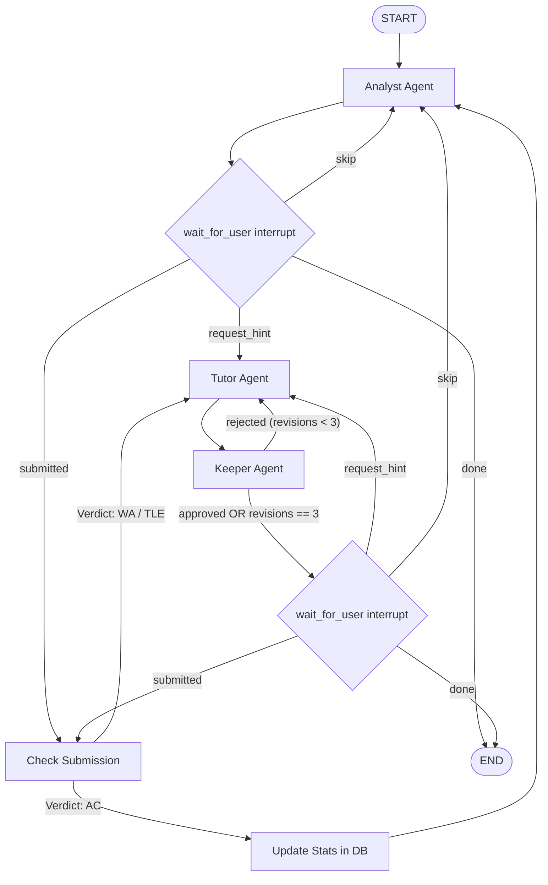

# 🏆 CP Coach: Multi-Agent Competitive Programming Coach

A multi-agent coaching system that connects to your **Codeforces** history, calculates your weak algorithmic topics using exponential decay and empirical Bayes shrinkage, picks a tailored practice problem, and coaches you with **graded, 3-tier hints that strictly never leak the solution**.

---

## 🎯 The Core Problem & Multi-Agent Justification

Standard LLMs and editorial walkthroughs spoil competitive programming problems by immediately revealing the key observation or full algorithm. Once spoiled, the active recall and problem-solving growth is lost.

CP Coach solves this through **Multi-Agent Information Asymmetry**:
- **Tutor Agent**: Sees *only* the problem statement and user chat history. It drafts hints at the requested tier (Level 1: Nudge, Level 2: Approach, Level 3: Pseudocode) without ever seeing the reference solution.
- **Keeper Agent**: An independent auditor that sees the reference solution (loaded privately from database storage) and verifies that the Tutor's draft does not leak algorithms, variable names, or solutions.
- **Analyst Agent**: Evaluates submission history, computes weak topics using deterministic math, and selects an optimal problem.

---

## 🏗️ Architecture & State Machine

